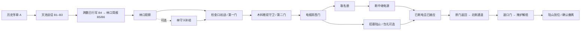

# S08 线性路线与情绪节奏

2026-10-13。本步交付路线图、任务节点、布景预留区、全部资源的区域索引、行走时间估算和 S09 贯通要求。**这是设计交付，尚未摆放新建筑、改动碰撞或调整正式玩法。** 当前可玩源码仍为 S07 的开场草案与既有林场任务，发布包仍为 0.6.1。

设计以现有四段路线为骨架：检查口 → 木料巷 → 电报房 → 北侧通道 → 渡口。保留人物和任务位置，通过侧面大体量、生产生活细节和远景层次充实画面；不用新增绕远路来凑时长。

## 快速查阅

- [路线与布景图 PNG](level/S08/route_map.png)：米制 X/Z 俯视图、现有阻挡、主路、可选补给、护送、敌人和拟放建筑。
- [结构化路线设计](level/S08/route_plan.json)：六个节奏区、9 个预留区、105 项资源索引与尺度限制，供后续制作直接读取。
- [105 项资源区域索引](level/S08/resource_assignments.md)：沿用 S02 编号与取舍；候选和备用仍单独标明。
- [实际导航调查](level/S08/source_survey.json)、[源码依据](level/S08/source_audit.json)、[设计核对结果](level/S08/validation.json)。
- [S09 贯通验收清单](level/S08/S09-handoff.md)：下一步只做简化体块和任务贯通，不提前完成精美建筑或人物动画。

## 1. 实际空间与不能破坏的接口

Godot 使用米制 X/Z 平面、Y 向上；本图北为 −Z。现有导航为 22×24 格，每格 4 米，主场地约 88×96 米。外围地面和河景超出该导航范围，属于景观，不增加可玩出口。图中灰格取自真实导航数据；它不是全部物理碰撞形状，树枝、箱边、低障碍等仍需实走检查。

| 锚点 | X/Z（米） | 必须保留的关系 |
|---|---|---|
| 玩家接管 | 10 / 86 | B 段正常结束／跳过均到此，已简报；直接开局仍需与姜岚交谈 |
| 姜岚 | 12 / 82 | 留在林口，不新增随队冲锋；初始谈话不越过 X>24 接敌边界 |
| 林守义 | 14 / 66 | 木棚补给可选，不把绕访设为主线门槛 |
| 木墙缺口 | 22 / 74 | 是接敌方向入口，不是三道任务栅门之一 |
| 第一门 | 34 / 58 | 已简报且 gate_guard 被击败，按 E 打开 |
| 第二门 | 34 / 42 | 第一门已开，yard_guard 与 timber_guard 被击败 |
| 电报房门 | 41.7 / 38 | 西侧唯一现有入口；伤员撤离仍从此返回，不假定有北门 |
| 名册 | 53.5 / 34 | 取册后 stage 0→1；不能以布景盖住任务桌 |
| 总闸 | 60 / 30.2 | 取册后才可断电，stage 1→2；布景避开交互视线 |
| 陆山 | 47 / 30 | 招募与取册／断电顺序独立；包扎可选，跟随／等候仍由玩家决定 |
| 北侧转向 | 34 / 22 至 67 / 22 | 出房后绕过北墙；不能用新厂房封死此通道 |
| 渡口门 | 70 / 22 | 第二门已开、stage=2、已招募陆山；不额外要求电报房守卫死亡 |
| 渡口接应 | 79 / 14 | 维持累计 12 秒解缆、两人到位与最后对话确认 |
| 两个追兵入口 | 78 / 50、78 / 54 | 四名追兵使用这两个固定入口，保留南北移动走廊和可见入口延后生成规则 |

既有初始守卫为 5 人、两批追兵合计 4 人、最多同时存活 6 人。首敌在已简报且 X>24 时激活，后面分区随门开启激活。**不以清空全部追兵为通关条件**；现有自动通关脚本会清敌，但这是测试策略。渡口解缆要求门开、stage=2、已招募且陆山跟随，玩家距接应点≤10米、陆山≤6米；最后撤离要求陆山<5.5米并满足既有互动条件。暂停、离开或让他等候会停计时，不清零。

## 2. 任务图与情绪安排

| 区域 | 情绪与空间安排 | 体验预算 | 要避免的失误 |
|---|---|---|---|
| Z0 林口观察与生活 | 天池的开阔感落到林口木墙，左侧生活摊棚、木棚和远处木屋建立有人生活过的地方；保留补问路线、拿补给的主动选择 | 35–55秒 | 不把新增闲谈变成重复简报，不在起点就激活敌人 |
| Z1 检查口初战 | 矮掩体、单一岗哨、明确栅门，帮助识别枪声和推进方式；右侧仓库形成主建筑轮廓 | 50–90秒 | 不用高货架挡住第一门，不增援抢占首次交火 |
| Z2 木料巷 | 两名守卫使交战升级；左右低货物提供层次，右侧锯木棚解释林场用途；清完后留可取医药包的短歇 | 65–115秒 | 不堆高面小物替代主体，不把备用补弹箱埋在新陈设中 |
| Z3 电报房 | 从交火压缩到室内近距离任务；桌、闸、伤员分别有清楚焦点；可读家书或包扎，用“救谁”回收战友情感 | 85–145秒 | 不强制包扎或先取册再救人；屏风不隔断陆山至西门的路 |
| Z4 北侧护送 | 玩家折返照应伤员，再绕北侧东行；厂房背景增强生产区层次，短暂降低强度，留换弹和回头确认距离的机会 | 40–75秒 | 不把这里设计成无条件安全区，office_guard 仍可能存活；不逼伤员跟着冲刺 |
| Z5 渡口 | 河面突然打开，南侧追兵带来最后压力；守住解缆站位，完成后迅速回落到并肩离开 | 45–80秒 | 不堵出生走廊、码头和等待区；不追加杀光追兵或额外计时门槛 |

上述预算合计 **320–560秒可玩段**，加约160.1秒开场，得到**初次展示约8–12分钟的设计目标**。这是待真人验证的预算，包含走动、瞄准、换弹、对话和可选短歇，没有新增强制停留。熟练玩家可更快，死亡重试会更慢。地图规模与交战强度未调整前，不承诺一定达到此时长；S09先记录实际可通关结果，S36再做真人节奏结论。

## 3. 预计行走时长：与体验预算分开

本步直接读取运行时导航网格，在内存中打开三门和电报房门后提取路线。调查没有驱动玩家行走，也没有替玩家完成任务。室内 R04b 沿既有 `combat_route.gd` 的走动节点计算；各段距离是明确折线的长度，不是几何最短路。4米格中心和精确目标之间会有回绕，适合后续比较，不适合当精确真人路径。

| 区域 / 路径 | 折线长度 | 3.8米/秒步行 | 6米/秒连续冲刺 |
|---|---:|---:|---:|
| Z0 / R01 起点至缺口前 | 20.0米 | 5.3秒 | 3.3秒 |
| Z1 / R02 缺口至第一门前 | 30.0米 | 7.9秒 | 5.0秒 |
| Z2 / R03 穿木料巷至第二门前 | 20.0米 | 5.3秒 | 3.3秒 |
| Z3 / R04a+b 进房、名册、总闸、陆山 | 55.2米 | 14.5秒 | 9.2秒 |
| Z4 / R05 陆山处出房、北侧至渡口门前 | 74.2米 | 19.5秒 | 12.4秒 |
| Z5 / R06 渡口门前至船边 | 22.0米 | 5.8秒 | 3.7秒 |
| **合计** | **221.4米** | **58.3秒** | **36.9秒** |

这些除法结果不含门锁、敌人、转身、减速、拾取、互动、伤员等待或12秒解缆，不能称为“整关一分钟”。蹲行当前为1.7米/秒，瞄准时乘0.65。陆山未包扎2.2米/秒、包扎后3.2米/秒；护送两段共96.2米，理论连续移动约43.7／30.1秒，实际还包含寻路与跟随停走，玩家需要照应他。

可选林守义补给路径 O01 为32米，替换20米的R01后**净增约12米／步行3.2秒**，交谈另占时间。O02 医药包在木料巷主路旁，沿线8米已包含于主线路径，不重复累加。家书、个人找掩体和回头接人的绕行未计入；它们不应成为凑够目标时长的强制支线。

## 4. 大型建筑与生活布景预留区

以下为 Xmin / Zmin → Xmax / Zmax 的**设计占地区间**，高度也是目标值。它们不是模型当前世界坐标，不表示已完成适配。S09用简化体块检查空间，S10/S11再选部件、缩放、改材质、制作碰撞。

| 槽位 | 区间与目标高度 | 资源与安排 | 先做什么 |
|---|---|---|---|
| D01 外围木屋整景 | −28/57 → −8/77；约5米 | `log_cabin_scene`，20×20米生活背景，服务林口与A2 | 拆源地面、复核门高与造型；边界外只能看见，不新增进入路线 |
| D02 林工生活木屋 | 5/48 → 17/58；约3.2米 | Retro Log Cabin 与 DAE 木屋择一；另一套留作外围变体 | 先统一米制与约2米门高，保留(14,66)林守义及原木棚 |
| D03 仓储主建筑 | 48/63 → 60/84；约8米 | `warehouse` 主体约10×17米；Nobiax 补墙补顶 | 从敞顶仓库改为完整外观，去现代设备；位置在木料巷南侧生产区，能从前两区观看 |
| D04 厂房背景 | 42/4 → 66/16；约7米 | `modular_factory_facade`，预留24×12米，两层外观 | 192个展列网格只选所需模块；南立面朝通道，距Z22中心线至少6米 |
| D05 锯木生产棚 | 48/49 → 60/55；约5米 | 水力锯木棚取棚架、台面等，约12×6米 | 没有引水渠，水轮保留给A2另设水边插镜；不在木料巷空转，旧箱堆先查冲突 |
| D06 林口生活摊棚 | 5/76 → 8/81；约2.5米 | `village_market` 拆1–2个摊位，靠西边缘 | 取旧布、木架、空筐和耐储货；整组9×10米不塞进林口 |
| D07 集散货摊 | 49/50 → 52/53；约2.5米 | `market_stalls` 单体与方筐，放D05棚内 | 子槽与棚共用布局，不重复叠一套屋顶与碰撞 |
| D08 电报房生活角 | 57/39 → 60/42；约1.6米 | 中式屏风只取1–2扇，加少量筐 | 东南角留生活痕迹，不把办公室改为装饰宫殿；保留任务桌和西门通行 |
| D09 木棚休息角 | 8/61 → 10/63；约0.5米 | 中式茶桌、木凳、方筐 | 配成低桌休息处，不增加必做互动，不挤林守义站位 |

东北特征优先落到木构民居、灰砖烟囱、窗格、柴垛、锯木与林工生活；有条件的原模型再做地域化加工。东北炕模型仍未下载，不能把候选图算进已用场景；S11可评估自制简化灶炕。两座偏日式塔楼继续备用；通用圆亭塔只有形制核对通过后才考虑独立远景，不硬摆在厂房旁。现代哈尔滨大剧院与大型宫殿候选仅留独立文旅展示／参考，不进1938年林场。

11组新建筑布景均在105项区域索引中：8组对应上表槽位，2组偏日式塔楼备用，1组通用塔为条件性远景。其余已下载模型、人物、表面、声音沿S02用途分配到区域或通用制作；库存完整性和年代改造问题仍沿S02登记。本步没有下载候选文件，也没有把任何新槽位标成已接入。天池DEM的实际状态单独更新为“S07过场参考已使用”，仍非艺术化成品。

## 5. 通行、视线与画面密度规则

1. 主路设计净宽至少2.4米；伤员转弯和玩家回头照应处至少3米；三道门原4米网格开口不缩窄。模型屋檐、树枝、门扇、碰撞盒也计入可用宽度，不仅看模型原点。
2. 任务物和人物附近保留约2.8米交互区，栅门前后保留3.3米可接近区；这是留空目标，不是将所有游戏交互距离统一改成该数。名册／总闸仍按既有2.3米判定。
3. 追兵走廊 X74–82、Z24–58 不放新增大体块；码头、系船桩之间和两人的解缆站位保留。追兵入口不可被无碰撞装饰假墙盖住。
4. 每区先有一个大轮廓、两三组有用途的中景，再补近景小物。高面树根、倒木、松树、小筐和灯笼限制重复，远处用低模与简材质；本步不虚报帧率收益。
5. 生活区与生产区共用秋季光照。冬雪仅用于A段蒙太奇；湖区灯光不混入林场。暂不在玩法中增加炮弹伤害或建筑破坏。
6. D01/D03/D04 服务大型展示，D05/D06解释用途；A2可以另调相机，但S07的镜头不会因新建筑自动构图合格。正式镜头在S32/S33复查，尤其A-11及接管手部明暗。

平面检查按0.1米采样比较9个矩形预留区与全部9条路线，最终最小中心线距离为2米（D06）；满足本步至少1.2米的半通道预留。**这只验证拟定矩形与参考折线，不验证模型、胶囊体、枪线、脚步接地或真实AI通行。** 原场景箱体、树木和新模型会产生的新冲突，需在S09/S13实际解决。

## 6. 天池前序与关卡连接

沿S03–S07：A段80秒宏大序章收束到天池意象；B1–B3沈砚与姜岚在岩台谈话，交代原定赴林区接应；B4时间地点卡在29.8–34.3秒跨越数日，姜岚先侦察后会合；B5才交代陆山昨夜受伤被扣的新情况。B6统一落回林场起点，不把艺术化天池坐标写进玩家可玩存档。

天池到林场使用剪辑连接，没有新增可玩长途道路，也不标未经考证的真实里程。S20–S23另建环形山壁、深蓝湖面、岩台和离开路径；展示空间要服务火山口湖想象。大远景与谈话近景属于同一艺术化湖区，但不承诺真实地理精度。人物舞台只保留沈砚／姜岚，陆山和林守义仍在林场。

## 7. 验证、修正与保存边界

- 实际运行Godot导航调查，得到9条折线、门位、任务锚点、守卫路线与追兵入口。最后 `survey.log` 无引擎／脚本错误；没有写用户游戏存档、移动角色或执行战斗。
- 首次调查工具错误设置了不存在的 `menu` 模式，触发HUD错误；已删除该赋值，保留 [初次日志](level/S08/initial-survey.log) 和初次数据，不把首轮称为通过。游戏源码未因此修改。
- 初次D06离可选路线仅1米，未通过半通道预留；已由X5–9缩为X5–8，最终2米。保留 [初次间距检查](level/S08/initial-clearance-validation.json)。
- 最终8项设计核对通过：105编号完整、槽位资源有效、平面间距、任务门位、预算加总、路线调查、旁白保留和源工程未改动。与S07完整备份比对，289个非日志源文件内容一致。
- 已查看最终路线图，确认任务锚点、文字、图例、外围区和情绪走向可读。文档与JSON核对见 [文档校验](level/S08/document_validation.json)。

本步没有重跑S07的242项回归或完整通关，不把历史通过数算成本轮结果；没有完成新建筑碰撞、性能或真人节奏验收。planning检查点保存本步文档、数据、图像、生成工具和日志；完整游戏回退仍用 [S07完整工程备份](../WorkBackups/20261013-144233-S07-done-83b039/CHECKPOINT.md)。本步最近检查点由 [PROGRESS.md](../PROGRESS.md) 指向。

下一步 **S09：简化路线完整贯通**，具体开工顺序和验收条件见 [交接清单](level/S08/S09-handoff.md)。
